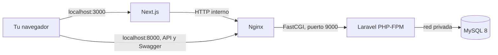

# Ecosistema Ecommerce con Docker

Proyecto académico que empaqueta el frontend Next.js y la API Laravel existentes en imágenes multi-stage y los conecta a MySQL mediante Docker Compose.

## Arquitectura



La aplicación tiene tres piezas principales: frontend, API y base de datos. Nginx es un contenedor de apoyo requerido para servir HTTP delante de PHP-FPM. El puerto de PHP-FPM no se publica en Windows; MySQL tampoco. La base de datos conserva sus datos en el volumen `mysql_data`.

## Requisitos

- Docker Desktop iniciado con el motor WSL 2.
- Git es opcional; los fuentes ya están incluidos en este repositorio.
- Conexión a internet la primera vez para descargar imágenes y dependencias.

## Iniciar en Windows

Desde PowerShell, en la carpeta raíz de este proyecto:

```powershell
Copy-Item .env.example .env
docker compose up --build
```

La configuración de ejemplo sirve para ejecución local académica. Antes de publicar o desplegar en un servidor, reemplazá las claves y contraseñas de `.env`. No subás `.env` a GitHub; sí se puede publicar `.env.example`.

El comando queda mostrando los registros de los contenedores; presioná `Ctrl+C` para detenerlos. Si preferís dejarlo corriendo en segundo plano, agregá `-d` al comando. Al iniciar, Laravel ejecuta las migraciones y agrega un catálogo de ejemplo de forma idempotente. El catálogo queda disponible al terminar el arranque.

## Abrir y comprobar

- Tienda Next.js: <http://localhost:3000>
- API de Laravel: <http://localhost:8000/api/products>
- Documentación Swagger: <http://localhost:8000/api/documentation>

La portada Next.js solicita los productos a `http://proxy/api` desde el servidor de Next. Laravel recibe la solicitud por Nginx y consulta MySQL. El navegador no se conecta directamente a MySQL ni al puerto PHP-FPM.

Comandos útiles:

```powershell
docker compose ps
docker compose logs -f frontend api proxy mysql
docker compose down
```

`docker compose down` conserva la base de datos. `docker compose down -v` borra también el volumen `mysql_data` y todos los datos guardados.

## Variables de entorno

| Variable | Uso |
| --- | --- |
| `APP_NAME` | Nombre de la aplicación Laravel. |
| `APP_ENV` / `APP_DEBUG` | Modo y detalle de errores de Laravel; el ejemplo usa valores de producción. |
| `APP_URL` | URL local que Laravel utiliza al generar enlaces. |
| `APP_KEY` | Cifrado de Laravel. En el ejemplo es una clave local de demostración. |
| `JWT_SECRET` | Firma de los tokens de autenticación. Cambiala antes de un despliegue real. |
| `LOG_LEVEL` | Nivel de detalle de los registros de Laravel. |
| `MYSQL_ROOT_PASSWORD` | Clave de administración inicial de MySQL. Solo la usa el contenedor de base de datos. |
| `MYSQL_DATABASE` | Base que inicializa MySQL y usa Laravel. |
| `MYSQL_USER` / `MYSQL_PASSWORD` | Cuenta de aplicación con acceso a la base configurada. |
| `NEXT_PUBLIC_STRIPE_PUBLISHABLE_KEY` | Clave pública de Stripe que Next incorpora durante el build. Para pagos, usar una clave de prueba válida. |
| `STRIPE_KEY` / `STRIPE_SECRET_KEY` | Claves de Stripe que usa Laravel. Para pagos, usar claves de prueba válidas y mantener la clave secreta fuera de GitHub. |

El archivo `.env.example` documenta las variables necesarias. Compose lee `.env` para completar la configuración.

## Decisiones en los Dockerfiles

### Frontend

- `deps` instala dependencias con `npm ci` usando primero solo `package.json` y `package-lock.json`; los cambios de código no invalidan esa capa.
- `builder` ejecuta `next build` y genera salida `standalone`.
- `runner` usa Node Alpine, contiene solo el servidor standalone, los recursos estáticos y los archivos públicos, y ejecuta como usuario sin privilegios.
- `.dockerignore` excluye dependencias locales, builds anteriores, archivos de entorno y reportes que no se necesitan para construir.

### API

- `php-base` instala PHP-FPM 8.2 Alpine y las extensiones de runtime necesarias, incluido `pdo_mysql`.
- La imagen oficial ya habilita `ctype`, `json`, `openssl` y `tokenizer`; la etapa base compila `pdo_mysql`, `mbstring`, `xml` y `dom`.
- `vendor` instala dependencias bloqueadas por `composer.lock`; los manifiestos se copian antes del código para aprovechar la caché. Composer y las herramientas de compilación no pasan a la imagen final.
- `api` copia el código de Laravel y únicamente la carpeta `vendor/` desde la etapa de dependencias. El proceso corre como `www-data`.
- El target `proxy` usa `nginx:alpine` y sirve los archivos públicos de Laravel hacia PHP-FPM.
- `.dockerignore` reduce el contexto y evita incluir `.env`, dependencias locales, pruebas y logs.

### Base de datos y Compose

- MySQL usa imagen oficial `mysql:8.0`, un volumen persistente y healthcheck.
- Compose espera a MySQL antes de iniciar migraciones, a PHP-FPM antes de iniciar Nginx y a Nginx antes de iniciar Next.js.
- Las redes separan el acceso web, la API y los datos. Solo Next.js y Nginx publican puertos locales; MySQL queda privado.

## Notas

- La clave pública de Stripe se incorpora al frontend durante el build. Si la cambiás en `.env`, reconstruí con `docker compose up --build -d`.
- La copia recibida del frontend espera que Laravel devuelva un `client_secret` y tenga una ruta de confirmación de pago. La API incluida todavía no expone esa ruta ni devuelve ese campo; por eso el flujo de pago requiere alinear esos endpoints antes de probarlo. La integración del catálogo con Laravel y MySQL sí está preparada.
- Una vez alineado el contrato de pago, el checkout también necesita claves válidas de Stripe en modo de prueba. Catálogo, registro e inicio de sesión local no requieren configurar Stripe.
- Para exponer esto en internet, reemplazá todas las claves de demostración y configurá HTTPS y secretos con el mecanismo del entorno de despliegue.
